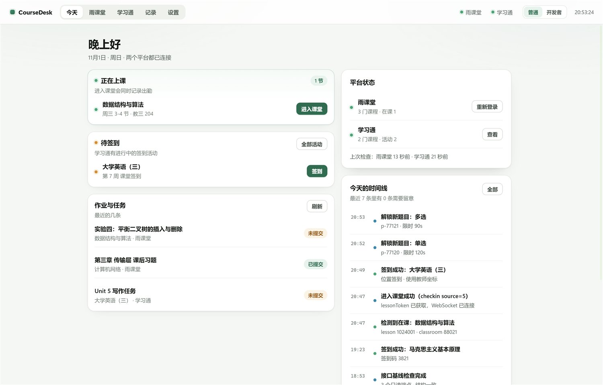
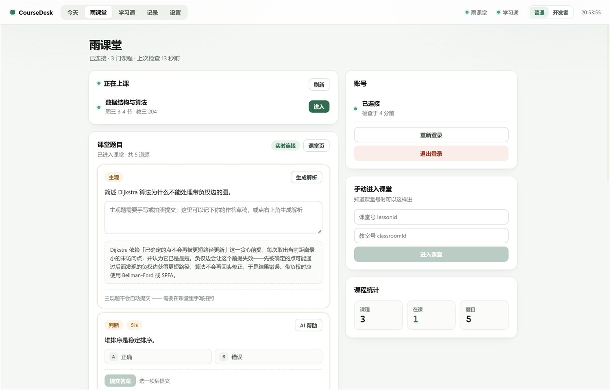
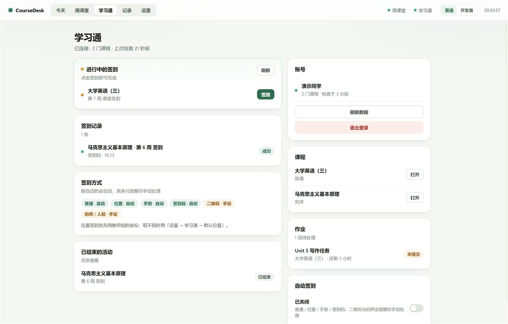
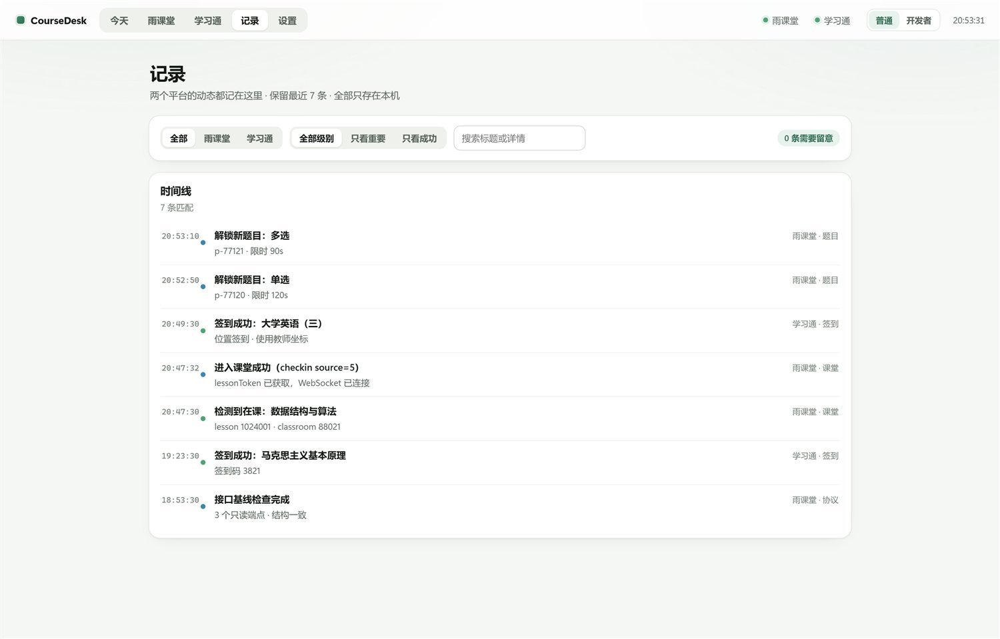
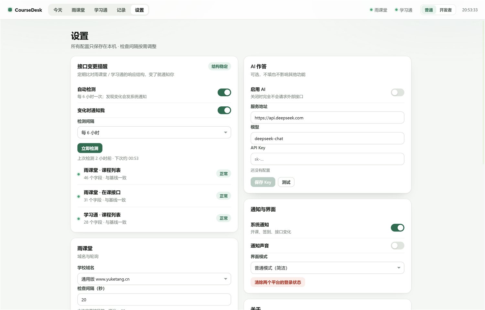
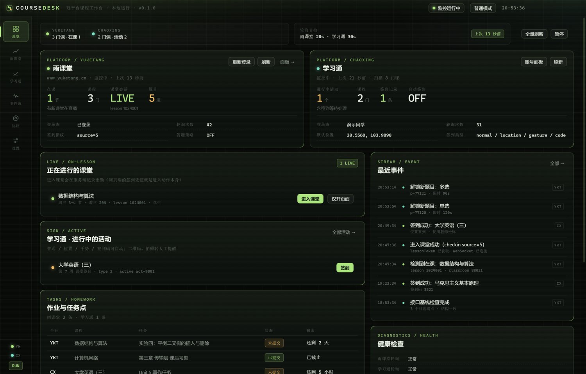
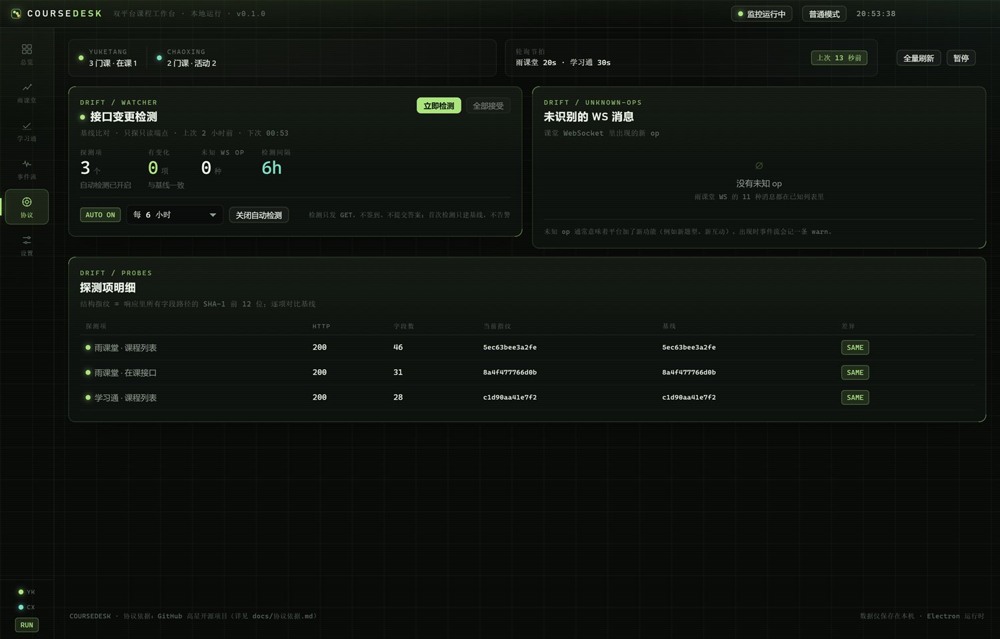

<div align="center">



<h1>CourseDesk</h1>

<p><b>雨课堂 × 学习通 · 双平台桌面课程工作台</b><br />
一个窗口看在课、随堂题、签到与作业；接口改版会告诉你，而不是悄悄失败。</p>

<p>
  <a href="https://github.com/Qiuizi/CourseDesk/releases"></a>
  
  <a href="https://github.com/Qiuizi/CourseDesk/stargazers"></a>
  
  
  
  
</p>

<p>
  <a href="https://qiuizi.github.io/CourseDesk/">在线介绍页</a> ·
  <a href="#下载与安装">下载</a> ·
  <a href="#界面">界面</a> ·
  <a href="docs/协议依据.md">协议依据</a> ·
  <a href="#常见问题">FAQ</a>
</p>

</div>

---

**CourseDesk** 把超星学习通和雨课堂收进一个 Windows 窗口：课程、在课、签到、随堂题、作业各自一屏，
两个平台的轮询各自独立。登录态和配置只留在本机；协议实现参考 GitHub 上的公开项目（见 [docs/协议依据.md](docs/协议依据.md)）。

- **普通模式**：浅色、少术语，能点的按钮。日常用这个。
- **开发者模式**：结构指纹、基线差异、主进程日志。排查用这个。
- 两套界面读同一份快照、发同一批 IPC，切换不打断正在跑的轮询。

> 个人本地测试用途：只操作自己的账号、只在自己的机器上跑、不对外提供服务。

## 目录

- [为什么做这个](#为什么做这个)
- [界面](#界面)
- [功能](#功能)
- [下载与安装](#下载与安装)
- [从源码运行](#从源码运行)
- [关键设计](#关键设计)
- [架构](#架构)
- [自检：截图与探针](#自检截图与探针)
- [数据与隐私](#数据与隐私)
- [已知限制](#已知限制)
- [常见问题](#常见问题)
- [声明](#声明)
- [English](#english)
- [License](#license)

## 为什么做这个

两个平台，两套登录，两个标签页。开课要盯、签到要抢、题目要翻课件 —— 真正麻烦的不是"没有工具"，
而是**状态散在四个页面里，而且失败时没有任何提示**。

CourseDesk 只做三件事：

1. **把状态收在一屏**：在课、待签到、作业、今天的时间线，按平台分色，重复事件折叠成 `×N`。
2. **把"该我动手了"推到眼前**：开课、新签到、提交失败都走系统通知（60 秒去重），不用守着刷新。
3. **把"平台变了"变成一条告警**：只打只读 GET，把响应字段路径做成结构指纹与基线比对；未知 WS `op` 计数。

它不替你上课，也不假装成功：每一次失败都会同时进事件流和 JSONL 日志。

## 界面

### 普通模式

| 今天 | 雨课堂 |
|---|---|
|  |  |

| 学习通 | 记录 |
|---|---|
|  |  |

课堂题目在普通模式里是**可点的**：单选 / 投票 / 判断点选项，多选可多选，填空按空输入；
AI 建议用虚线高亮并带 `AI` 标；主观题只出解析，永远不自动提交。提交前会显示"将提交 A、C"这类预览。

设置页把**接口变更提醒**放在最上面 —— 每个探测项的字段数、基线、差异都能就地接受：



### 开发者模式

总览、雨课堂、学习通、事件流、协议、设置六页，带接口结构指纹、基线差异明细、未识别 WS op 与主进程日志。

| 总览 | 协议检测 |
|---|---|
|  |  |

## 功能

| 能力 | 雨课堂 | 学习通 |
|---|---|---|
| 登录 | 内嵌浏览器微信扫码，cookie 落 Electron persist 分区 | 账号密码（AES 加密提交）或网页扫码 |
| 课程列表 | `/v2/api/web/courses/list` | `mooc1-api/mycourse/backclazzdata` |
| 轮询监控 | 在课接口，可配 15s 起 | 逐课程 `activelist`，带请求抖动 |
| 进入课堂 / 签到 | `POST /api/v3/lesson/checkin`（`source` 指纹可配） | `pptSign/stuSignajax`，失败补 `preSign` |
| 实时课堂 | 自建 `wss://<host>/wsapp/`，解析 11 种 op | — |
| 随堂题 | 从 `presentation/fetch` 取题干选项，按题型构造提交体 | — |
| AI 作答 | OpenAI 兼容接口；`off / confirm / auto` 三档；主观题只出解析 | — |
| 签到类型 | — | 普通 / 位置 / 手势 / 签到码自动；二维码、拍照转人工 |
| 作业 | `mooc-api` exercise list（依赖 leafId） | `work/task-list` HTML 解析 |
| 视频进度 | `video-log/heartbeat/` 按真实播放器事件形状上报（默认关） | — |
| 系统通知 | 开课、新签到、提交失败（60s 去重）；后台/托盘状态照常弹 Windows Toast | 同左 |
| 后台常驻 | 关闭窗口收到托盘，轮询与提醒继续；可开机自启 | 同左 |
| 自动更新 | GitHub Releases + electron-updater，启动 12s 后检查、之后每 4 小时；安装版一键重启安装 | 同左 |
| 事件流 / 记录 | 两个平台统一时间线 + 主进程日志 | 同左 |
| 接口变更检测 | 只读端点结构指纹 + 基线 diff + 未识别 WS op | 同左 |
| 界面 | 普通 / 开发者双模式，随时切换 | 同左 |

## 下载与安装

从 [Releases](https://github.com/Qiuizi/CourseDesk/releases) 取最新构建（Windows x64）：

| 文件 | 体积 | 说明 |
|---|---|---|
| `CourseDesk-0.1.1-portable.exe` | 105 MB | 便携版，双击即用，不写注册表；拷走 exe 就能换机器 |
| `CourseDesk-0.1.1-setup.exe` | 116 MB | NSIS 安装包，可自选目录，建桌面 / 开始菜单快捷方式 |
| `win-unpacked/`（可选） | 约 315 MB | 免安装目录，直接跑 `CourseDesk.exe` |

未配置代码签名证书，首次运行 SmartScreen 会提示"更多信息 → 仍要运行"。

## 从源码运行

```bash
# Node ≥ 22（本项目在 Node 26 / Electron 45 上验证）
git clone https://github.com/Qiuizi/CourseDesk.git
cd CourseDesk
npm install

npm run dev       # 开发模式（HMR）
npm run build     # 产出 out/
npm start         # 预览构建产物
npm test          # 协议层纯函数单测（17 项，含独立实现的 AES 对照向量）
```

打包：

```bash
npm run pack       # 单文件便携版 → release/CourseDesk-0.1.1-portable.exe
npm run pack:nsis  # 安装包     → release/CourseDesk-0.1.1-setup.exe
npm run pack:dir   # 免安装目录 → release/win-unpacked/
```

首次安装如果 Electron 二进制下载慢：

```bash
ELECTRON_MIRROR=https://npmmirror.com/mirrors/electron/ npm install
```

### 首次使用

1. 「设置」确认雨课堂域名（`www` / `pro` / 学校自建子域）。
2. 「雨课堂 → 扫码登录」，微信扫码；窗口关掉后会自动探测登录态。
3. 学习通二选一：账号密码，或「网页登录」扫码。
4. 回「今天」，两个平台都有课程数即接通。两个平台的轮询节拍可在设置里单独调。

登录态是 Electron 的 persist 分区：cookie 在 `%APPDATA%/CourseDesk/Partitions/coursedesk`，重启复用。
协议层用 `session.fetch` 发请求，业务代码不搬 cookie。

## 关键设计

### 1. 雨课堂签到 = "进入课堂这个动作"

网页端没有独立的"签到按钮接口"。教师开启签到后，学生进入课堂即出勤，进入动作本身就是
`POST /api/v3/lesson/checkin`，同时换回 `lessonToken`（WS 握手的 auth）。所以「进入课堂」做三件事：

```
轮询 on-lesson → checkin(source) → 拿 lessonToken + identityId
                                  ├─ 建 WS（自管课堂事件与随堂题）
                                  └─ 按需打开课堂页（页面自身 WS 也在跑）
```

`source` 是渠道指纹（5 = 网页端「正在上课」，25 = 上课提醒，21 = APP 扫码……），服务端按它记录出勤渠道。

### 2. 随堂题从哪来

`/api/v3/lesson/presentation/fetch?presentation_id=` 的 `data.slides[]` 里，每页可能带 `problem`。
WS 的 `unlockproblem` 只给 problemId 和限时，所以：

```
unlockproblem(problemId, limit, pres)
  → 已缓存 slides → presentation/fetch → problem/detail
```

| type | 题型 | `result` |
|---|---|---|
| 1 / 3 | 单选 / 投票 | `["A"]` |
| 2 | 多选 | `["A","C"]`（去重升序） |
| 4 | 填空 | `["答案1","答案2"]`（按空序） |
| 5 | 主观 | `{content, pics:[{pic:""}], videos:[]}` —— **不自动提交** |
| 6 | 判断 | `["A"]` / `["B"]` |

两套界面的题目卡都走同一个提交体，只是一个手打字母、一个点选 / 填空。

### 3. 答题策略

- `off`：纯人工，题目只展示。
- `confirm`：AI 生成答案 → 填进题目卡 → 你改完点提交。
- `auto`：客观题直接提交。

主观题（type 5）在任何策略下都只生成解析文本，从不提交 —— 代码级硬规则。

### 4. 学习通签到

`activelist` → `getPPTActiveInfo`（拿教师指定坐标 / 签到码）→ `pptSign/stuSignajax`，失败补 `newsign/preSign`。

| 方式 | 判定依据 | 默认 |
|---|---|---|
| 位置 | 详情里带经纬度 | 自动（教师坐标优先，否则用设置里的默认位置） |
| 签到码 | `signcode` 是 4–8 位数字 | 自动 |
| 手势 | `signcode` 不是纯数字 | 自动 |
| 二维码 | `otherInfo` 含 `enc` | 转人工（enc 十秒一变） |
| 拍照 / 人脸 | 响应含关键词 | 转人工 |

### 5. 接口变更检测（drift）

只打**只读 GET**（课程列表、在课列表、活动列表），把响应里所有字段路径排序取 SHA-1 前 12 位当结构指纹：

```
首次检查 → 只建基线，不告警
之后每次 → 指纹不同就记 added / removed 字段路径，推 warn 事件 + 系统通知
人工确认 → 「接受」把当前指纹写成新基线（单条或全部）
```

同一套告警还统计课堂 WS 里没见过的 `op`。开发者模式「协议」页看明细，普通模式在「设置 → 接口变更提醒」看人话版本。

### 6. 视频进度心跳

`video-log/heartbeat/` 的 `heart_data[]` 按真实播放器形状构造（`i=20`、`p=web`、`lob=ykt`、`source=ks`、
`cp` 单调递增，末尾补一条到片尾）。默认关闭，需要手动触发（「课件与视频」卡片填 presentationId → 上报）。

## 架构

```
┌───────────────────────── 渲染进程（React 19 + Vite） ─────────────────────────┐
│  普通模式 5 页（simple/）      开发者模式 6 页（components/ + dev/）           │
│  只通过 preload 暴露的 window.coursedesk 调主进程，没有 node 权限               │
└───────────────────────────────┬──────────────────────────────────────────────┘
                                │ IPC（contextBridge）
┌───────────────────────────────▼──────────────────────────────────────────────┐
│  主进程                                                                       │
│  ┌───────────────┐  ┌──────────────────┐  ┌───────────────────────────────┐  │
│  │ Engine        │  │ 协议客户端        │  │ 支撑层                        │  │
│  │ 监控循环       │  │ YtClient         │  │ persist 分区 + session.fetch  │  │
│  │ 事件总线       │  │  ├ courses       │  │ JsonStore（原子写 + 防抖）     │  │
│  │ 快照推送       │  │  ├ checkin       │  │ safeStorage 加密（AI Key）     │  │
│  │ 答题调度       │  │  ├ presentation  │  │ 环形日志 + JSONL 落盘          │  │
│  │ Drift 调度     │  │  └ answer/video  │  │ 系统通知 / 托盘 / 全局快捷键    │  │
│  └───────────────┘  │ YtLessonSocket   │  └───────────────────────────────┘  │
│                     │ ChaoxingClient   │                                     │
│                     └──────────────────┘                                     │
└───────────────────────────────────────────────────────────────────────────────┘
```

两条"登录"路径共用同一个 cookie 分区，所以「扫码登录 → 协议层立刻可用」不需要额外传参。
界面模式只是 `settings.ui.mode` 的一个字段，切换不重建 Engine。

## 自检：截图与探针

渲染层有两条自检通道，都不碰真实账号：

```bash
# 1) 一次性截图：预写 state.json 的 ui.mode，启动 → 截图 → 退出
node scripts/shoot2.mjs simple:today simple:settings dev:overview dev:drift

# 2) CDP 探针：真实窗口里执行表达式，顺带抓 console / 截图
node scripts/probe.mjs --mode simple --tab yuketang --demo --shot shots/x.png \
  --expr "return { problems: document.querySelectorAll('.s-problem').length }"
```

`--demo` 注入一份形状真实的演示快照（两门课在课、5 道题覆盖单选/多选/填空/判断/主观、
学习通一条进行中签到、3 条接口基线），**只读本地、不发任何请求、不落盘**。
探针会把渲染进程 `console` 与未捕获异常一并打出来 —— 样式被写坏（例如 CSS 注释少个 `*/`
把后面整段规则吞掉）这类问题就是靠它发现的。

环境变量：`COURSEDESK_DEMO=1`、`COURSEDESK_TAB=<tab>`、`COURSEDESK_WINDOW=1440x920`、`COURSEDESK_SHOT=<png>`。

介绍页源码在 [`site/`](site/index.html)，无构建步骤、无外部资源：整站是 9 屏的演示，滚轮 / ↑↓ / 触屏上下滑一次翻一页——
旧页先淡出、新页 200ms 后跟进淡入（PPT 式，只有交接的 100ms 会重叠）；每屏按视口高度重排过，1440×900 / 1366×768 / 1280×720 都一屏装下，更矮或更窄时才在页内滚动；
右侧章节点可直接跳转，`#why` 这类锚点也走同一套。截图切换同样是淡出→换页→淡入。
`prefers-reduced-motion` 下保留透明度过渡，去掉位移与缩放。
推 `site/**` 后由 [`.github/workflows/pages.yml`](.github/workflows/pages.yml) 部署到 GitHub Pages。想在本地看一眼：

```bash
node_modules/electron/dist/electron.exe scripts/preview.cjs -- \
  "$(pwd)/site/index.html" shots/site.png 1440 1000 1500
```

`scripts/preview.cjs` 会加载任意 URL、打印 console、截图后退出；`PREVIEW_SCROLL=<px>` 可截长页的某一段。

## 更新与后台

三个能力都走系统原生通道，不引入额外服务：

### 自动更新（electron-updater + GitHub Releases）

- 打包时 `publish` 指向 `Qiuizi/CourseDesk`，`npm run pack:nsis` 会同时产出 `latest.yml` 与 `app-update.yml`。
- 启动 12 秒后查一次，之后每 4 小时一次；设置里也有「检查更新」。
- 只有 **NSIS 安装版**能自动升级（下载完点「重启并安装」即 `quitAndInstall`）；便携版会明确提示去 Releases 下载新版。
- 发版时把 `latest.yml`、安装包、`.blockmap` 一起传到 Release；缺 `latest.yml` 会得到一句「这次发布缺少 latest.yml」，而不是一整段堆栈。
- 目录：`src/main/core/updater.ts`；IPC：`update:check` / `update:install`；状态在快照的 `update` 字段，两个界面都能读。

### Windows 通知

- 启动时 `app.setAppUserModelId('com.coursedesk.app')`（与安装包 `appId` 一致），否则 Windows 会把 Toast 归到 electron 名下或直接吞掉。
- 开课、新签到、提交失败、接口变更、更新就绪都走 `notify()`；点 Toast 会把窗口拉回前台。
- 设置里「发一条测试通知」可直接验证系统权限。

### 关闭后继续在后台

- 默认「关闭窗口后继续在后台运行」：点 × 只是 `hide()`，轮询、答题、通知都还在；首次隐藏会弹一条说明。要退出用托盘菜单。
- 关掉这个开关后，点 × 会真的退出。
- 「后台时也提醒」「开机自启」分别在设置里；自启走 `app.setLoginItemSettings({ openAtLogin })`，改完立刻生效。

排查：通知不弹 → 看 Windows 设置里 CourseDesk 的通知权限；更新检查 404 → 确认 Release 里上传了 `latest.yml`；便携版提示不支持 → 正常，改用安装版。

### 资源占用

- 快照推送限流：窗口可见最多 3 次/秒，收进托盘后 5 秒一次，恢复显示时立即补一次。
- 窗口隐藏时暂停所有 CSS 动画与 1s tick 计时器；托盘里的进程只保留轮询。
- 事件载荷超过 1 KB 只留 `{truncated, bytes, keys}`，保留条数 300 → 200，避免长期运行时快照越推越大。
- 两套界面都去掉了 `backdrop-filter` 这类常驻合成开销；右上角三个窗口按钮改成自绘的小圆点（浅色 / 深色各一套皮肤），不再依赖系统 caption，切模式不会闪。
- 模式切换加了一层同色过场：铺满 → 换界面 → 再淡出，切换时的挂载抖动与换底色都被盖在遮罩后面。
- 「设置 → 关于 → 完全退出 CourseDesk」或托盘菜单退出，避免关窗后误以为退出而文件被占用。

## 数据与隐私

| 数据 | 位置 | 说明 |
|---|---|---|
| cookie / 登录态 | `%APPDATA%/CourseDesk/Partitions/coursedesk` | Electron 管理，退出账号即清 |
| 设置 / 事件 / 缓存 | `%APPDATA%/CourseDesk/state.json` | 原子写，250ms 防抖 |
| AI Key | 同上 `secrets.aiKey` | `safeStorage`（Windows DPAPI）加密，不回传渲染进程 |
| 日志 | `%APPDATA%/CourseDesk/logs/coursedesk-YYYYMMDD.jsonl` | 环形 600 条 + 按天文件 |

所有请求由主进程发起；渲染进程没有直连外网的代码路径（CSP 也限制了）。

## 已知限制

1. **雨课堂作业列表**需要课程的 `leafId`，部分学校接口不返回 → 作业区为空是预期行为，不影响课堂功能。
2. **`presentation/active`、`problem/detail`** 字段各校有差异，代码做了多字段兜底；仍失败时题干显示"未取到"，但 WS 事件不会丢。
3. **学习通 `activelist`** 随版本变化，解析走宽松匹配 + 原始响应入日志，解析不到会在事件流告警而不是静默。
4. **二维码 / 拍照 / 人脸签到**不做自动，只提醒。
5. **判断题选项**部分部署不下发，普通模式补 `A 正确 / B 错误` 兜底；学校用别的编码时以题干为准。
6. **视频心跳**是"上报已有进度"，不是解码视频；默认关闭。
7. 平台改版会打破协议。所有失败进事件流，`未知 WS op` 会计数。

## 常见问题

<details>
<summary>登录态和数据存在哪？</summary>

cookie 在 `%APPDATA%/CourseDesk/Partitions/coursedesk`；设置、事件、缓存与 AI Key 在 `state.json`
（Key 用 Windows DPAPI 加密）；日志按天写到 `logs/coursedesk-YYYYMMDD.jsonl`。全部只在本机。
</details>

<details>
<summary>作业列表是空的？</summary>

雨课堂作业需要课程的 `leafId`，部分学校不下发。这不影响课堂、签到与题目。
</details>

<details>
<summary>AI 会自己提交答案吗？</summary>

看设置：`off` 不调用模型；`confirm` 只把建议填进题目卡；`auto` 仅对客观题生效。主观题在任何档位都只生成解析。
</details>

<details>
<summary>二维码 / 人脸签到怎么办？</summary>

转人工：应用提醒你去官方页面处理，不尝试识别或伪造。
</details>

<details>
<summary>学校用自建域名？</summary>

设置 → 雨课堂 → 学校域名，填 `pro.yuketang.cn` 或学校子域即可。
</details>

<details>
<summary>会不会被平台判定异常？</summary>

轮询节拍默认 20s / 30s，可在设置里调慢；签到走官方接口与官方渠道指纹。**能否使用取决于你所在学校的规定**，
请自行确认后再用。
</details>

## 声明

个人本地测试用途：只操作自己账号、只在自己机器上跑、不对外提供服务。
协议细节来自公开开源项目，随平台更新可能失效；使用前请确认所在学校 / 单位的相关规定。

## English

<sub>CourseDesk is a Windows desktop workbench for two Chinese course platforms — **Rain Classroom (雨课堂)** and
**XueXiTong / Chaoxing (学习通)**. It puts live classes, in-class quizzes, sign-in activities and homework into one
window, with two UI modes: a plain light mode for daily use and a developer console that fingerprints each read-only
endpoint and warns you when a platform changes shape.

Everything runs locally: cookies live in an Electron persist partition, settings and an optional AI key stay in
`%APPDATA%\CourseDesk`, and no server sits in between. Quizzes can be answered by hand or with an OpenAI-compatible
model (`off / confirm / auto`), but subjective questions are never auto-submitted. Sign-in support covers normal,
location, gesture and code-based. QR / photo / face sign-in is handed back to you on purpose.

Downloads are Windows x64 only (portable `.exe` + NSIS installer). Protocol details come from public open-source
projects; platform changes can break them, so every failure is surfaced in the event log instead of failing silently.</sub>

## License

[MIT](LICENSE) © Qiuizi

---

<div align="center"><sub>介绍页源码在 <a href="site/index.html">site/</a> · 协议依据在 <a href="docs/协议依据.md">docs/协议依据.md</a></sub></div>
